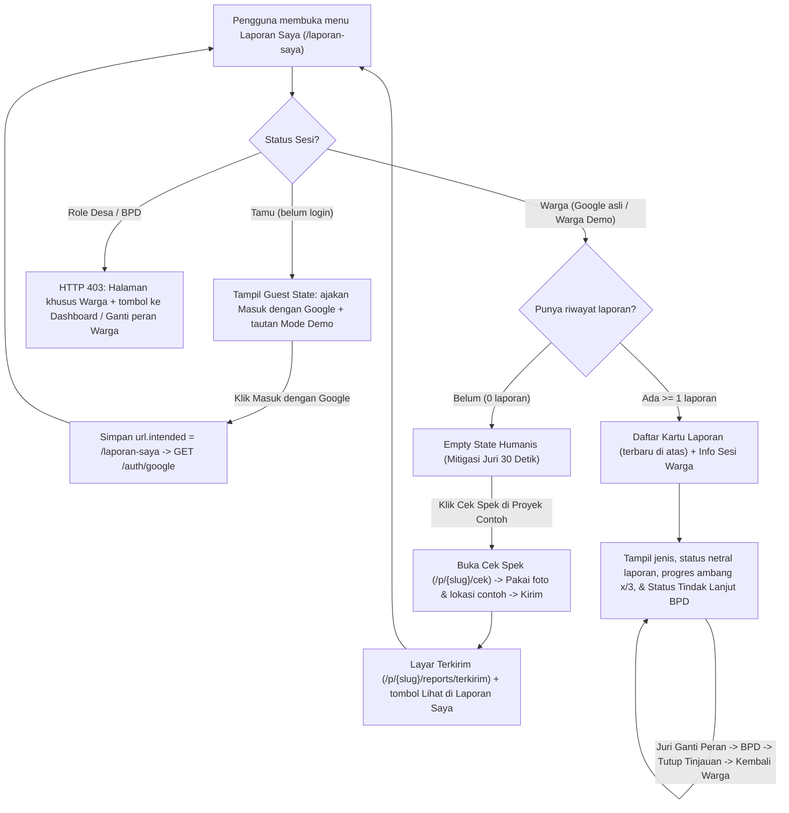

# Spesifikasi PRD: Fitur "Laporan Saya" (`/laporan-saya`) — Menutup Siklus Pengawasan Warga

> **Modul:** M4 (`Report`) · Integrasi M5 (`Review`), M3 (`Project`), & M6 (`Demo`)  
> **Versi Dokumen:** 1.0  
> **Status:** Siap Implementasi (Estimasi: ~1–2 Hari Kerja)  
> **Risiko Teknis:** Rendah — **0 migrasi database baru** (100% memakai tabel eksisting)  
> **Dokumen Acuan:** `docs/DECISIONS.md` (D-001 s.d. D-011), `docs/DESIGN.md`, `docs/ENGINEERING.md`, `docs/prd/PRD-Fitur-Pemdes.md`, `docs/prd/PRD-Fitur-v1.2-Adendum-Strategis.md`

---

## 1. Ringkasan Eksekutif & Nilai Strategis

### 1.1 Latar Belakang Masalah
Selama ini, perjalanan warga di Sonar Desa berakhir pada layar konfirmasi `GET /p/{slug}/reports/terkirim` (*"Laporanmu masuk ke BPD"*). Begitu warga menutup halaman proyek, tidak ada satu ruang khusus bagi warga untuk memantau nasib laporannya:
- Apakah laporan Cek Spek miliknya masih aktif dihitung menuju ambang tinjauan (`x dari 3 warga`)?
- Apakah laporan lamanya tergantikan setelah mengirim laporan baru?
- Apakah proyek yang ia laporkan sudah masuk status **`Dalam tinjauan BPD`** atau sudah selesai **`Ditinjau BPD`** beserta hasil keputusan dan catatan resmi BPD?

Kondisi ini rentan memicu pertanyaan kritis dewan juri: **"Setelah warga melapor, lalu apa? Dari mana pelapor tahu laporannya benar-benar diproses?"**

### 1.2 Solusi: Menu "Laporan Saya" (`GET /laporan-saya`)
Menambahkan satu menu khusus di navigasi warga (mobile & desktop) menuju **`/laporan-saya`** untuk menampilkan riwayat laporan Cek Spek milik akun warga yang sedang aktif — **termasuk akun `Warga (demo)` yang otomatis login per sesi demo**.

### 1.3 Nilai Penilaian Lomba & Kelayakan Teknis
| Aspek Penilaian | Dampak Fitur "Laporan Saya" |
| :--- | :--- |
| **Tema & Solusi (25%)** | Menjawab langsung pertanyaan *"setelah warga melapor, lalu apa?"* dan menutup siklus pengawasan partisipatif (`Warga -> Cek Spek -> Ambang BPD -> Tindak Lanjut BPD -> Transparansi balik ke Pelapor`) **tanpa** membangun infrastruktur notifikasi WhatsApp/Email (yang tetap berada di `OUT PRD`). |
| **Feasibility & Logika** | **Rendah risiko (~1–2 hari kerja)**. Menggunakan 100% tabel eksisting (`reports`, `projects`, `villages`, `review_cycles`, `review_notes`, `users`) tanpa migrasi baru dan tanpa perubahan pada `VillageCloner`. |
| **Pengalaman Juri (30 Detik Pertama)** | Juri yang baru membuka web belum memiliki riwayat laporan. Mitigasi wajib: **Empty State humanis** dengan CTA langsung ke proyek contoh (`Rabat Beton Jl. Melati RT 02/03`) untuk mencoba Cek Spek. Begitu juri menekan **"Pakai foto & lokasi contoh"** dan mengirim, laporan demo tersebut **langsung muncul** di halaman **Laporan Saya** dan terus tersinkron saat juri menguji alur BPD (`Ganti peran -> BPD -> tutup tinjauan -> kembali ke Warga`). |

---

## 2. Lingkup Fitur (In-Scope vs Out-of-Scope)

### 2.1 Termasuk Lingkup (IN SCOPE)
1. **Menu & Titik Masuk Navigasi Warga:**
   - Tab/item **"Laporan Saya"** di `BottomNav.vue` (mobile) dan `DesktopSidebar.vue` (desktop), serta pintasan pasca-kirim di halaman konfirmasi `Submitted.vue` dan beranda `Home.vue` (saat akun warga / demo warga aktif).
2. **Daftar Riwayat Laporan Milik Akun Aktif:**
   - Nama proyek (+ nama desa & tahun anggaran) dengan tautan langsung ke halaman rincian proyek (`/p/{slug}`).
   - Tanggal & waktu lapor dalam format **WITA** (UTC ISO 8601 dari server, diformat via `lib/format.ts`).
   - Jenis laporan (`Sesuai`, `Selisih`, `Tidak bisa diukur` dari `ReportKind`).
   - Status laporan netral (`Aktif dihitung`, `Digantikan`, atau `Tidak dihitung`) **tanpa** membocorkan kolom sensitif internal seperti `invalid_reason`, koordinat mentah, maupun `device_hash`.
   - Progres ambang proyek pada siklus laporan tersebut (`x dari 3 warga`, sinkron dengan aturan ambang `config('sonar.review.threshold')`).
3. **Status Tindak Lanjut BPD (Sinkron dengan M5):**
   - Status proyek: belum dalam tinjauan (`none`), **`Dalam tinjauan BPD sejak ...`** (`in_review`), atau **`Ditinjau BPD: Ditindaklanjuti` / `Tidak ada selisih`** (`reviewed`).
   - Saat berstatus `reviewed`, menampilkan hasil resmi (`ReviewOutcome`), catatan keputusan BPD (`review_cycles.note`), tanggal putusan (`closed_at`), dan daftar catatan susulan resmi (`review_notes`).
4. **Info Sesi Warga & Tombol Keluar:**
   - Untuk **akun Google asli**: menampilkan info akun warga yang sedang aktif + tombol **Keluar** (`POST /logout`).
   - Untuk **akun Warga Demo**: menampilkan keterangan sesi demo terisolasi tanpa membocorkan alamat email internal `@demo.sonar-desa.test` dan tanpa tombol `/logout` (kontrol peran tetap memakai `Ganti peran` / `Mulai ulang demo` di `DemoBanner` / `DesktopSidebar`).
5. **Penanganan Tamu (Guest), Role Non-Warga, & Empty State Juri 30 Detik:**
   - Tamu (belum login & belum demo): tampilan ramah untuk masuk dengan Google (kembali ke `/laporan-saya` setelah OAuth) atau mencoba Mode Demo.
   - Akun `Role::Desa` / `Role::Bpd`: ditolak `403` dengan halaman penjelas netral dan tombol kembali ke dashboard masing-masing / ganti ke peran Warga di mode demo.
   - Warga tanpa laporan (khususnya Juri pada 30 detik pertama): Empty State IDDS dengan tombol langsung ke proyek contoh untuk mencoba Cek Spek.

### 2.2 Di Luar Lingkup (OUT OF SCOPE / `OUT PRD`)
- Notifikasi push, WhatsApp, SMS, atau email saat status BPD berubah.
- Penampilan ulang foto laporan (`report_photos`) atau titik koordinat GPS (`lat`/`lng`) milik pelapor di halaman `/laporan-saya` (menghindari endpoint media privat baru dan menjaga lingkup tetap ramping).
- Pengeditan atau penghapusan laporan langsung dari halaman `/laporan-saya` (perubahan laporan tetap melalui kirim ulang Cek Spek pada proyek terkait sesuai aturan `C10`).
- Pengajuan banding atau kolom komentar dua arah antara warga dan BPD di dalam aplikasi.

---

## 3. Alur Pengguna & Skenario Penutupan Siklus Pengawasan



### 3.1 Alur Uji Cepat Juri (Closing the Loop dalam < 90 Detik)
1. Juri membuka Beranda (`/`) lalu menekan **"Buka Desa Contoh"** -> `DemoSession` otomatis membuat salinan desa terisolasi dan meloginkan akun **`Warga (demo)`**.
2. Juri menekan tab **"Laporan Saya"** di `BottomNav` atau `DesktopSidebar`.
3. Karena akun `Warga (demo)` sesi ini belum mengirim laporan, halaman menampilkan **Empty State** yang mengarahkan langsung ke proyek contoh **`Rabat Beton Jl. Melati RT 02/03`** (yang di data awal `ProjectSeeder` telah memiliki **2 laporan Selisih valid**).
4. Juri menekan **"Cek Spek di Proyek Contoh"**, menekan **"Pakai foto & lokasi contoh"**, memilih **"Ada yang tidak sesuai"**, lalu mengirim laporan.
5. Di layar konfirmasi **`Laporanmu masuk ke BPD`**, juri melihat ambang tercapai (`3 dari 3 warga`) lalu menekan **"Lihat di Laporan Saya"** (atau lewat menu navigasi).
6. Laporan demo tadi langsung tampil di `/laporan-saya` dengan status **`Aktif dihitung`**, progres **`3 dari 3 warga`**, dan Status Tindak Lanjut BPD **`Dalam tinjauan BPD sejak ...`**.
7. *(Opsional lanjutan)* Juri menekan **"Ganti peran" -> "BPD"**, menyelesaikan tinjauan proyek dengan hasil **`Ditindaklanjuti`** + catatan resmi BPD, lalu kembali ke peran **"Warga"** dan membuka **"Laporan Saya"** -> kartu laporannya otomatis tersinkron menjadi **`Ditinjau BPD: Ditindaklanjuti`** lengkap dengan catatan resmi BPD!

---

## 4. Aturan Bisnis & Invarian Produk

### LS-R1 · Kontrol Akses, Guest, dan Redirect Auth
- Route utama: `GET /laporan-saya` (`name('reports.mine')`), didaftarkan di `app/Modules/Report/routes.php`.
- **PENTING (Kesesuaian `bootstrap/app.php`):** Saat ini `bootstrap/app.php` mengarahkan tamu (`redirectGuestsTo`) ke `auth.google` **hanya** untuk route `reports.check` dan `reports.submitted`, sedangkan route `auth` lainnya diarahkan ke `/login` (form email/password Pemdes & BPD!).
  - Oleh karena itu, `GET /laporan-saya` **tidak** langsung memantulkan tamu ke `/login` maupun memaksa redirect ke Google OAuth saat baru mengetuk tab navigasi.
  - Saat `$request->user() === null`, controller merender state **Guest** pada halaman `/laporan-saya`.
  - Tombol **"Masuk dengan Google"** pada state Guest diarahkan ke endpoint penerus khusus (misalnya `GET /laporan-saya/masuk` dengan middleware `auth`, dan menambahkan `'reports.mine.login'` ke daftar `routeIs(...)` di `bootstrap/app.php` agar `redirectGuestsTo` mengarahkan ke `route('auth.google')` dengan `url.intended` menunjuk ke `/laporan-saya`, lalu setelah login mengembalikan pengguna ke `/laporan-saya`).
  - Manfaat ganda: (a) mengetuk tab navigasi tidak langsung melempar pengunjung ke halaman Google eksternal; (b) di lingkungan lokal tanpa kredensial Google OAuth, juri/developer tetap melihat halaman informatif beserta pintu ke Mode Demo.
- **Role Guard:** Jika `$request->user()` sudah login tetapi bukan `Role::Warga` (`Desa` atau `Bpd`), `Gate::denies('viewOwn', Report::class)` mengembalikan status **HTTP `403`** dengan tampilan ramah (serupa pola `report/Forbidden.vue`) yang menawarkan tautan kembali ke `/desa` atau `/bpd`, atau tombol **"Ganti ke peran Warga"** bila sedang dalam sesi demo.

### LS-R2 · Status Laporan & Aturan Privasi Ketat (`ENGINEERING.md` §2)
Setiap baris pada tabel `reports` milik `$user->id` dipetakan secara deterministik di backend menjadi enum `CitizenReportStatus`:

| Kondisi Database (`reports`) | Nilai Enum (`snake_case`) | Label UI (`lib/labels.ts`) | Warna `Badge` | Keterangan Pendamping Netral |
| :--- | :--- | :--- | :--- | :--- |
| `superseded_by !== null` | `superseded` | `Digantikan` | `neutral` | *"Digantikan oleh laporan terbarumu pada siklus proyek ini."* |
| `superseded_by === null && invalid_reason !== null` | `not_counted` | `Tidak dihitung` | `neutral` | *"Tidak masuk hitungan ambang tinjauan oleh BPD."* |
| `superseded_by === null && invalid_reason === null` | `active` | `Aktif dihitung` | `positive` | Jika `kind === 'mismatch'`: *"Masuk hitungan progres ambang tinjauan BPD."*<br>Jika `kind !== 'mismatch'`: *"Laporan tercatat aktif; tinjauan BPD dipicu oleh laporan selisih."* |

**Invarian Privasi Mutlak:**
- Kolom `reports.invalid_reason` **TIDAK PERNAH** dikirim ke props Inertia (bahkan pada halaman milik pelapor sendiri) guna mencegah bocornya catatan internal verifikasi BPD atau celah manipulasi aturan validasi.
- Kolom `reports.lat`, `reports.lng`, `reports.accuracy_m`, `reports.distance_m`, `reports.device_hash`, `users.google_id`, dan data pelapor lain **TIDAK PERNAH** dikirim ke props.
- Data identitas akun Google (seperti `session.email`) hanya boleh dikirim ke props privat `/laporan-saya` bila `$user->google_id !== null`, dan **tidak pernah** ditambahkan ke shared props `HandleInertiaRequests::share()`.

### LS-R3 · Sinkronisasi Progres Ambang (`x dari 3 warga`) & Data M5 (`review_cycles` + `review_notes`)
Mengingat mekanisme `SubmitReviewOutcome` di M5 menutup `ReviewCycle` lama (`closed_at !== null`) dan memindahkan `projects.current_cycle_id` ke `$nextCycle` baru yang masih kosong, logika pembacaan **wajib** mengacu pada siklus laporan yang relevan agar angka tidak keliru menjadi `0 dari 3`:

1. **Progres Ambang Proyek (`mismatch_count`):**
   - `threshold` selalu berasal dari `(int) config('sonar.review.threshold')` (default `3`), bukan angka statis di Vue.
   - `current` dihitung untuk **pasangan `(project_id, cycle_id)` milik laporan tersebut**:
     - Jumlah `DISTINCT user_id` di tabel `reports` dengan `project_id = report.project_id`, `cycle_id = report.cycle_id` (mendukung `IS NULL` ketika `cycle_id === null`), `kind = 'mismatch'`, `invalid_reason IS NULL`, `superseded_by IS NULL`.
   - Untuk laporan pada siklus yang sudah ditutup (`cycle.closed_at !== null`), angka ini tetap merefleksikan hitungan pelapor selisih pada siklus saat laporan tersebut dikirim (misal `3 dari 3 warga`), bukan `0 dari 3` dari siklus baru.
2. **Status Tindak Lanjut BPD (`bpd_review`):**
   - **Prioritas 1 — Siklus laporan sudah ditutup (`$report->cycle?->closed_at !== null`):**
     - `status = 'reviewed'`, mengambil `outcome` (`ReviewOutcome::FollowedUp` -> `"Ditindaklanjuti"`, `ReviewOutcome::NoMismatch` -> `"Tidak ada selisih"`), `note` (`review_cycles.note`), `in_review_since`, `reviewed_at` (`closed_at`), serta daftar `notes` dari `review_notes` milik siklus tersebut urut kronologis (`created_at ASC`).
   - **Prioritas 2 — Proyek berstatus `PublicStatus::InReview` pada siklus berjalan:**
     - `status = 'in_review'`, mengambil `in_review_since` dari `$project->currentCycle?->in_review_since`.
   - **Prioritas 3 — Proyek berstatus `PublicStatus::Reviewed` (misal laporan dikirim di siklus baru setelah tinjauan sebelumnya selesai):**
     - Mengikuti kontrak `ProjectResource` (M3/M5): mencari `ReviewCycle` tertutup terbaru milik proyek tersebut (`closed_at !== null`, urut `closed_at DESC, id DESC`), menampilkan hasil + catatan resmi + `review_notes`, disertai penanda opsional `submitted_after_review: true` bila `report.created_at > reviewedCycle.closed_at` agar tidak membingungkan warga.
   - **Prioritas 4 — Proyek berstatus `PublicStatus::None`:**
     - `status = 'none'` -> pesan netral bahwa proyek belum berstatus dalam tinjauan BPD.

### LS-R4 · Info Sesi Warga & Tombol Keluar (`POST /logout`)
- **Akun Google Asli** (`page.props.auth.user !== null && page.props.demo === null`):
  - Menampilkan kartu ringkas info sesi: label `"Masuk dengan Google"`, nama (`Warga`), dan alamat email akun Google yang sedang aktif (dari prop privat halaman, bukan shared props) sebagai penanda bagi warga yang memiliki lebih dari satu akun Google.
  - Menyediakan tombol sekunder/aksi **"Keluar"** yang mengeksekusi `POST /logout` (`route('logout')` -> `LoginController::destroy`, yang membersihkan sesi dan mengarahkan ke Beranda `/`).
- **Akun Warga Demo** (`page.props.demo !== null`):
  - Menampilkan kartu info sesi demo: badge `demo` (`"Sesi Warga Demo"`), nama desa demo aktif, serta keterangan netral bahwa laporan tersimpan khusus di salinan demo sesi ini dan akan ter-reset bila menekan *"Mulai ulang demo"*.
  - **Tidak** menampilkan email internal `demo-warga-{id}@demo.sonar-desa.test` dan **tidak** menampilkan tombol `POST /logout` (sesuai arahan fitur dan agar penguji tidak terputus dari `DemoSession` secara tidak sengaja; pergantian peran tetap melalui `Ganti peran` di `DemoBanner` / `DesktopSidebar`).

### LS-R5 · Kepatuhan Isolasi Desa & Larangan `if ($village->is_demo)` (`ENGINEERING.md` §2)
- Modul M4 (`Report`) **dilarang** menulis pengecekan `if ($village->is_demo)` di dalam Action, Controller, maupun Resource.
- Untuk menjamin laporan yang tampil hanya berasal dari proyek terbit yang sah diakses sesi saat ini, `GetCitizenReports` memakai `Project::withoutGlobalScope('village')` yang dimuat bersama `village`, lalu menyaring dengan **`VillageVisibility::allows($request, $project->village)`** milik Core (mengizinkan seluruh proyek terbit desa nyata, serta mengizinkan proyek demo **hanya** milik sesi demo yang aktif).
- Untuk menentukan tautan **"Proyek Contoh"** di Empty State tanpa `if ($village->is_demo)`:
  - Jika `$user->village_id !== null` (kondisi alami akun warga yang terikat pada satu desa tertentu, seperti akun klon `VillageCloner`), server mencari proyek terbit yang memiliki koordinat (`lat`, `lng` tidak null) dan ukuran Cek Spek (`measurements`) di desa `$user->village_id` tersebut — prioritaskan proyek yang memiliki jumlah pelapor selisih aktif terbanyak namun belum `in_review` (di data `ProjectSeeder`, ini otomatis memilih **`Rabat Beton Jl. Melati RT 02/03`** yang sudah `2 dari 3 warga`!).
  - Jika `$user->village_id === null` (akun Google warga lintas desa), Empty State mengarahkan warga untuk membuka Beranda (`/`) / memindai QR plang proyek di lokasi.

### LS-R6 · Bahasa Netral & Format Waktu
- Seluruh waktu dikirim server sebagai string ISO 8601 UTC (`->toIso8601String()`) dan diformat di browser **hanya** melalui `formatDate` / `formatDateTime` di `resources/js/lib/format.ts` (menghasilkan format `27 Nov 2026, 22.15 WITA`).
- Seluruh teks UI disimpan di `resources/js/lib/labels.ts`.
- Wajib lolos `sh scripts/check-neutral-language.sh` (bebas kata: `korupsi`, `mark-up`, `markup`, `curang`, `penyelewengan`).

---

## 5. Spesifikasi Antarmuka (UI/UX) & Navigasi

### 5.1 Pembaruan Navigasi Warga (Mobile & Desktop)
Seluruh tampilan mengikuti `docs/DESIGN.md` (IDDS mode terang, token semantik Tailwind v4, font Inter, mobile-first dari lebar **360 px** tanpa scroll horizontal, target sentuh minimal **44 × 44 px**).

1. **`BottomNav.vue` (Mobile `< md`, `h-16`):**
   - Saat ini `BottomNav.vue` memiliki 2 tab berbeda (`Beranda` dan `Cari desa`) yang keduanya sama-sama menuju `href="/"`. Pada lebar layar `360 px`, mempertahankan 5 tab sekaligus berisiko memadatkan ruang horizontal di bawah batas nyaman untuk label `"Laporan Saya"`.
   - **Penyesuaian:** Satukan menjadi **4 tab seimbang** di `BottomNav.vue`:
     1. **`Desa` / `Beranda`** (`href` ke `/d/{villageSlug}` bila sedang berada di konteks desa atau `demo.village_slug`, selain itu `/`) — `activeTab === 'cari-desa'`
     2. **`Laporan Saya`** (`href="/laporan-saya"`) — `activeTab === 'laporan-saya'`, ikon clipboard/daftar cek, pill `bg-primary-subtle text-primary` saat aktif
     3. **`Pindai QR`** (button `tabClick('pindai-qr')`)
     4. **`Bantuan`** (button `tabClick('bantuan')`)
   - *Opsional ringan:* jika akun aktif memiliki laporan yang berstatus `in_review` atau `reviewed`, boleh menampilkan titik indikator kecil (`h-2 w-2 rounded-full bg-primary`) atau angka jumlah laporan tanpa membuat tab meluap.
2. **`DesktopSidebar.vue` (Desktop `md+`, lebar `260 px`):**
   - Tambahkan item **`Laporan Saya`** (`<Link href="/laporan-saya">`) tepat di bawah **`Cari Desa`** pada grup `MENU UTAMA`, dengan gaya identik dan status aktif `activeTab === 'laporan-saya'`.
   - Pada halaman `/laporan-saya`, dialog **`Pindai QR`**, **`Bantuan`**, dan **`Buka Plang Proyek`** tetap berfungsi konsisten seperti di `Village.vue` / `Show.vue`.
3. **`RootLayout.vue`:**
   - Tambahkan `'report/MyReports'` ke `pagesWithDesktopSidebar` agar pada breakpoint `md+`, `DemoBanner` atas otomatis disembunyikan dan digantikan oleh kartu demo di `DesktopSidebar` (menghindari duplikasi banner demo di desktop).
4. **`Submitted.vue` & `Home.vue`:**
   - Pada `Submitted.vue` (bagian aksi setelah `"Kembali ke halaman proyek"`), tambahkan tombol/tautan **`Lihat di Laporan Saya`** (`href="/laporan-saya"`) agar juri/warga bisa langsung berpindah satu klik seusai mengirim laporan.
   - Pada `Home.vue`, tampilkan pintasan ringan menuju `/laporan-saya` (mis. kartu/tautan ringkas bila `auth.user?.role === 'warga'` atau `demo?.role === 'warga'`).

### 5.2 Struktur Layar Halaman `/laporan-saya`

```
+------------------------------------------------------------------+
| [Desktop: DesktopSidebar 260px]  |  [Konten Utama max-w-4xl]     |
| - Logo Sonar Desa                |  Header (Mobile: sticky bar   |
| - Cari Desa                      |  "Laporan Saya" + kembali)    |
| - [AKTIF] Laporan Saya           |                               |
| - Pindai QR / Bantuan / Plang    |  1. Kartu Info Sesi Warga     |
| - Kartu Demo (jika mode demo)    |     (Google + Keluar / Demo)  |
|                                  |                               |
|                                  |  2. Ringkasan Partisipasi     |
|                                  |     (Total · Aktif · Ditinjau)|
|                                  |                               |
|                                  |  3. Daftar Kartu Laporan      |
|                                  |     [Card Laporan #1]         |
|                                  |     [Card Laporan #2]         |
|                                  |     (atau Empty State 30 dtk) |
+------------------------------------------------------------------+
| [Mobile < md: BottomNav 4 tab (Desa | Laporan Saya | QR | Bantuan)]
```

#### Detail Komponen per Kartu Laporan (`ReportHistoryCard.vue`)
Menggunakan `Card.vue` (`rounded-lg border border-stroke bg-surface`) dengan hierarki visual IDDS:
1. **Header Kartu:**
   - Nama Proyek (`text-base sm:text-lg font-semibold text-content`), nama desa & tahun anggaran (`text-xs text-content-secondary`), serta timestamp lapor WITA (`formatDateTime(report.created_at)`).
2. **Baris Lencana Status Laporan & Jenis:**
   - `Badge` Jenis Laporan (`Sesuai` = `positive`, `Selisih` = `warning`, `Tidak bisa diukur` = `neutral`).
   - `Badge` Status Laporan (`Aktif dihitung` = `positive`, `Digantikan` = `neutral`, `Tidak dihitung` = `neutral`) + 1 kalimat penjelas netral di bawahnya.
   - *(Opsional ringkas)* Jika pelapor menulis `note` pribadi saat mengirim, tampilkan kutipan singkat catatan miliknya sendiri (maks. 2 baris) sebagai pengingat konteks laporan tersebut.
3. **Blok Progres Ambang Proyek:**
   - Menampilkan label `"Progres ambang proyek"` dan angka server `"x dari 3 warga"` (`tabular-nums font-bold`).
   - Progress bar tersegmentasi (konsisten dengan `Submitted.vue`, menggunakan `bg-info-solid` saat ambang tercapai / ditutup dan `bg-warning-solid` saat masih berjalan menuju ambang).
4. **Blok Status Tindak Lanjut BPD (Sinkron M5):**
   - **`in_review` (`Dalam tinjauan BPD`):** Kotak `border-warning-border bg-warning-subtle text-warning` menampilkan `Dalam tinjauan BPD sejak {tanggal}` + penjelasan netral *"Laporan warga pada proyek ini sedang diperiksa oleh BPD."*
   - **`reviewed` (`Ditinjau BPD`):** Kotak `border-info-border bg-info-subtle text-info` menampilkan:
     - Judul: **`Ditinjau BPD: Ditindaklanjuti`** atau **`Ditinjau BPD: Tidak ada selisih`** (`publicStatus.reviewed`) + tanggal putusan WITA (`formatDate(reviewed_at)`).
     - Catatan resmi putusan BPD (`review.note`).
     - Daftar **Catatan Tindak Lanjut BPD** (`review.notes` dari `review_notes`, bila ada) beserta tanggal masing-masing catatan.
     - Keterangan tambahan netral jika laporan dikirim pada siklus baru setelah putusan tersebut.
   - **`none` (Belum masuk tinjauan):** Kotak netral `bg-surface-subtle border-stroke` bertuliskan *"Belum masuk tinjauan BPD. Tinjauan dimulai otomatis bila terdapat 3 pelapor selisih valid dari lokasi."*
5. **Footer Kartu:**
   - Tautan/tombol `secondary` atau `ghost` (`min-h-11`): **`Lihat rincian proyek`** (`-> /p/{slug}`), dan bila berstatus `Digantikan` atau proyek masih terbuka, opsi ringan **`Kirim laporan baru`** (`-> /p/{slug}/cek`).

#### Detail Empty State (Mitigasi Juri 30 Detik)
- Memakai `EmptyState.vue` dengan ilustrasi IDDS (`plang-empty` atau `search-empty`):
  - **Judul:** *"Kamu belum mengirim laporan Cek Spek"*
  - **Deskripsi:** *"Ikut awasi pembangunan fisik desa langsung dari lokasi. Laporanmu tercatat untuk BPD dan dapat dipantau tindak lanjutnya di sini."*
  - **Jika ada proyek contoh (`suggested_project` tersedia, mis. `Rabat Beton Jl. Melati RT 02/03` di mode demo):**
    - Tombol `primary` (`h-11`): **`Coba Cek Spek di Proyek Contoh`** (`-> /p/{slug}/cek`)
    - Tombol `secondary` (`h-11`): **`Lihat Daftar Proyek Desa`** (`-> /d/{village_slug}`)
    - Helper alert/info ringkas: *"Tips uji cepat: di halaman Cek Spek, tekan 'Pakai foto & lokasi contoh' lalu kirim — laporanmu akan langsung muncul di sini."*
  - **Jika warga Google asli (`suggested_project` null):**
    - Tombol `primary` (`h-11`): **`Jelajahi Proyek Desa`** (`-> /`).

---

## 6. Spesifikasi Teknis & Kontrak Data

### 6.1 Skema Database (0 Migrasi Baru)
Memanfaatkan penuh tabel yang sudah ada:
- `reports` (`id`, `project_id`, `cycle_id`, `user_id`, `kind`, `note`, `superseded_by`, `invalid_reason`, `created_at`)
- `projects` (`id`, `village_id`, `slug`, `name`, `year`, `lat`, `lng`, `public_status`, `current_cycle_id`, `published_at`)
- `villages` (`id`, `name`, `slug`, `regency`)
- `review_cycles` (`id`, `project_id`, `opened_at`, `in_review_since`, `closed_at`, `result`, `note`)
- `review_notes` (`id`, `cycle_id`, `note`, `created_at`)
- `users` (`id`, `name`, `email`, `role`, `village_id`, `google_id`)

### 6.2 Kontrak Props Inertia (`GET /laporan-saya`)

```ts
export type CitizenReportStatus = 'active' | 'superseded' | 'not_counted';

export interface MyReportBpdNote {
    note: string;
    created_at: string | null;
}

export interface MyReportBpdReview {
    status: 'none' | 'in_review' | 'reviewed';
    in_review_since: string | null;
    outcome: 'followed_up' | 'no_mismatch' | null;
    note: string | null;
    reviewed_at: string | null;
    notes: MyReportBpdNote[];
    submitted_after_review: boolean;
}

export interface MyReportItem {
    id: number;
    created_at: string;
    kind: 'mismatch' | 'match' | 'unmeasurable';
    status: CitizenReportStatus;
    note: string | null;
    project: {
        name: string;
        slug: string;
        village_name: string;
        village_slug: string;
        year: number;
    };
    mismatch_count: {
        current: number;
        threshold: number;
    };
    bpd_review: MyReportBpdReview;
    urls: {
        project: string;
        check: string;
    };
}

export interface MyReportsPageProps {
    state: 'guest' | 'authenticated';
    session: {
        auth_type: 'google' | 'demo';
        display_name: string;
        email: string | null; // null untuk demo & guest
        village_name: string | null;
        village_slug: string | null;
    } | null;
    summary: {
        total_count: number;
        active_count: number;
        reviewed_or_in_review_count: number;
    };
    reports: MyReportItem[];
    suggested_project: {
        name: string;
        slug: string;
        village_name: string;
        urls: {
            project: string;
            check: string;
        };
    } | null;
    urls: {
        google_login: string;
        demo: string;
        home: string;
        logout: string;
    };
}
```

### 6.3 Rancangan Komponen Backend (Modular Monolith)
1. **Routes (`app/Modules/Report/routes.php` & `bootstrap/app.php`):**
   - `GET /laporan-saya` -> `[MyReportsController::class, 'index']` (`->name('reports.mine')`, tanpa redirect paksa saat tamu).
   - `GET /laporan-saya/masuk` -> `[MyReportsController::class, 'signIn']` (`->middleware('auth')->name('reports.mine.login')`), ditambahkan ke `$request->routeIs('reports.check', 'reports.submitted', 'reports.mine.login')` pada `bootstrap/app.php` sehingga tamu otomatis diarahkan ke `route('auth.google')` dan kembali ke `/laporan-saya` setelah OAuth sukses.
2. **Enum (`app/Modules/Report/Enums/CitizenReportStatus.php`):**
   - Backed string enum: `Active = 'active'`, `Superseded = 'superseded'`, `NotCounted = 'not_counted'`.
3. **Policy (`app/Modules/Report/Policies/ReportPolicy.php`):**
   - Tambahkan `public function viewOwn(User $user): bool` -> `return $user->hasRole(Role::Warga);`.
4. **Action (`app/Modules/Report/Actions/GetCitizenReports.php`):**
   - Menerima `Request $request` & `User $citizen`.
   - Mengambil `Report::query()->where('user_id', $citizen->id)` dengan eager loading `project.village`, `project.currentCycle.notes`, `project.reviewCycles.notes`, `cycle.notes`, diurutkan `latest('created_at')->latest('id')`.
   - Menyaring laporan sehingga hanya proyek terbit (`$project->isPublished()`) yang lolos `VillageVisibility::allows($request, $project->village)` yang disertakan.
   - Menghitung jumlah pelapor selisih valid (`DISTINCT user_id`) secara **batch** per `(project_id, cycle_id)` (1 query agregasi per pasangan proyek-siklus yang ada di daftar, **bebas N+1**).
   - Menentukan `suggestedProject` bila daftar laporan kosong dan `$citizen->village_id !== null` (memilih proyek terbit di desa tersebut yang memiliki koordinat dan ukuran, diurutkan agar proyek contoh dengan progres ambang mendekati threshold muncul lebih dulu).
5. **Controller & Resource:**
   - `app/Modules/Report/Http/Controllers/MyReportsController.php`
   - `app/Modules/Report/Http/Resources/CitizenReportHistoryResource.php`

### 6.4 Daftar Berkas Terdampak (Perkiraan)
- **Backend:**
  - `bootstrap/app.php` (tambah `reports.mine.login` pada `redirectGuestsTo`)
  - `app/Modules/Report/routes.php`
  - `app/Modules/Report/Enums/CitizenReportStatus.php` *(baru)*
  - `app/Modules/Report/Policies/ReportPolicy.php`
  - `app/Modules/Report/Actions/GetCitizenReports.php` *(baru)*
  - `app/Modules/Report/Http/Controllers/MyReportsController.php` *(baru)*
  - `app/Modules/Report/Http/Resources/CitizenReportHistoryResource.php` *(baru)*
  - `app/Modules/Report/Http/Resources/SubmittedReportResource.php` (tambah `urls.my_reports` -> `route('reports.mine')`)
- **Frontend:**
  - `resources/js/types/report.ts`
  - `resources/js/lib/labels.ts`
  - `resources/js/layouts/RootLayout.vue` (tambah `'report/MyReports'` ke `pagesWithDesktopSidebar`)
  - `resources/js/components/ui/BottomNav.vue`
  - `resources/js/components/ui/DesktopSidebar.vue`
  - `resources/js/features/report/ReportHistoryCard.vue` *(baru)*
  - `resources/js/pages/report/MyReports.vue` *(baru)*
  - `resources/js/pages/report/Submitted.vue` (tautan ke `/laporan-saya`)
  - `resources/js/pages/project/Village.vue` & `resources/js/pages/project/Show.vue` (tambahkan `activeTab` / `villageSlug` bila perlu konsistensi navigasi)
- **Testing:**
  - `tests/Feature/Report/MyReportsTest.php` *(baru)*

---

## 7. Acceptance Criteria (AC) & Rencana Pengujian

### 7.1 Matriks Acceptance Criteria
| ID | Kondisi Awal (Given) | Aksi (When) | Hasil yang Diharapkan (Then) |
|---|---|---|---|
| **LS-01** | Pengunjung belum login dan tidak dalam sesi demo | Membuka `GET /laporan-saya` | Halaman tampil dengan status 200 (state `guest`), tanpa data laporan apa pun, menampilkan tombol **"Masuk dengan Google"** (`-> /laporan-saya/masuk`) dan pintasan ke Mode Demo. |
| **LS-02** | Pengunjung belum login | Mengakses `GET /laporan-saya/masuk` | Diarahkan ke `GET /auth/google` (bukan `/login` Pemdes), dan `url.intended` mengarah ke `/laporan-saya`. |
| **LS-03** | Pengguna login dengan `Role::Desa` atau `Role::Bpd` | Mengakses `GET /laporan-saya` | Server mengembalikan HTTP `403` beserta opsi kembali ke dashboard masing-masing (atau **"Ganti ke peran Warga"** saat mode demo). |
| **LS-04** | Akun `Warga (demo)` baru memulai sesi demo (0 laporan) | Membuka `GET /laporan-saya` | Menampilkan Empty State humanis dengan CTA langsung ke proyek contoh (`Rabat Beton Jl. Melati RT 02/03`) untuk Cek Spek + tips memakai *"Pakai foto & lokasi contoh"*. |
| **LS-05** | Akun `Warga (demo)` mengirim laporan Cek Spek (via *"Pakai foto & lokasi contoh"*) | Kembali ke `/laporan-saya` (baik via tombol di layar Terkirim maupun navigasi) | Laporan demo tersebut langsung tampil di urutan teratas dengan tanggal WITA, jenis laporan, status `Aktif dihitung`, dan progres `x dari 3 warga`. |
| **LS-06** | Warga Google mengirim laporan ke-1 (`Sesuai`), lalu mengirim laporan ke-2 (`Selisih`) di proyek & siklus sama | Membuka `/laporan-saya` | Kedua laporan muncul urut terbaru di atas: laporan ke-2 berstatus `Aktif dihitung`, laporan ke-1 berstatus `Digantikan`. |
| **LS-07** | BPD menandai sebuah laporan tidak valid (`invalid_reason = "Foto tidak relevan"`) | Pelapor membuka `/laporan-saya` | Status laporan tampil netral sebagai `Tidak dihitung`. Props Inertia **tidak** mengandung `invalid_reason`, `lat`, `lng`, `device_hash`, atau `google_id`. |
| **LS-08** | Proyek yang dilaporkan warga mencapai 3 pelapor selisih valid (`public_status = in_review`) | Pelapor membuka `/laporan-saya` | Kartu laporan menampilkan `3 dari 3 warga` dan status tindak lanjut **`Dalam tinjauan BPD sejak ...`** (WITA). |
| **LS-09** | BPD menutup tinjauan proyek (`Ditindaklanjuti` + catatan + 1 catatan susulan `review_notes`, sehingga `current_cycle_id` bergeser ke siklus baru) | Pelapor dari siklus tersebut membuka `/laporan-saya` | Kartu laporan tetap menampilkan progres ambang siklus tersebut (tidak mendadak `0 dari 3`), status **`Ditinjau BPD: Ditindaklanjuti`**, catatan resmi putusan BPD, dan catatan susulan BPD (sinkron dengan M5). |
| **LS-10** | Warga A dan Warga B melapor di desa yang sama; atau Sesi Demo A dan Sesi Demo B aktif bersamaan | Warga A membuka `/laporan-saya` | Hanya laporan milik Warga A yang tampil; laporan Warga B dan Sesi Demo lain tidak pernah muncul. |
| **LS-11** | Warga login dengan akun Google asli | Melihat blok sesi di `/laporan-saya` dan menekan **"Keluar"** (`POST /logout`) | Info sesi Google tampil (tanpa email demo), tombol Keluar memanggil `POST /logout`, mengakhiri sesi, dan mengarahkan ke `/`. |
| **LS-12** | Warga sedang dalam sesi `Warga (demo)` | Membuka `/laporan-saya` | Menampilkan badge sesi demo terisolasi (tanpa email `@demo.sonar-desa.test` dan tanpa tombol `POST /logout`). |
| **LS-13** | Warga membuka `/laporan-saya` di viewport `360 px` dan `1440 px` | Mengakses lewat browser HP & desktop | Tidak ada horizontal overflow/scroll, seluruh tap target $\ge 44\times44\text{ px}$, navigasi `BottomNav` (mobile) & `DesktopSidebar` (desktop) aktif sempurna, `DemoBanner` tidak dobel di desktop. |
| **LS-14** | Seluruh perubahan selesai | Menjalankan pemeriksaan CI lokal (`make test`, `make lint`, `check-neutral-language.sh`) | Seluruh unit/feature test Postgres, Pint, Larastan, ESLint, Prettier, `vue-tsc`, Vitest, dan neutral language guard lulus 100%. |

---

## 8. Rencana Eksekusi (~1–2 Hari Kerja) & Mitigasi Risiko

| Tahap | Estimasi | Rincian Pekerjaan |
|---|---|---|
| **Hari 1 (Pagi)** | ~3–4 jam | Backend M4: buat `CitizenReportStatus`, `ReportPolicy::viewOwn`, `GetCitizenReports` (query batch bebas N+1 + sinkronisasi M5), `CitizenReportHistoryResource`, `MyReportsController`, update `routes.php`, `bootstrap/app.php`, `SubmittedReportResource`. |
| **Hari 1 (Siang–Sore)** | ~3–4 jam | Backend Feature Tests (`MyReportsTest.php`) di Postgres asli mencakup AC LS-01 s.d. LS-12 (termasuk uji privasi `assertInertia`, isolasi antar-sesi demo, dan siklus M5 yang sudah ditutup). |
| **Hari 2 (Pagi)** | ~3–4 jam | Frontend M4: tambah types `report.ts`, string copy di `lib/labels.ts`, komponen `ReportHistoryCard.vue`, halaman `MyReports.vue` (Guest, Forbidden/403, Empty State 30 Detik, Daftar Riwayat), update `BottomNav.vue`, `DesktopSidebar.vue`, `RootLayout.vue`, dan `Submitted.vue`. |
| **Hari 2 (Siang)** | ~2 jam | QA responsif `360 px` & `1440 px`, uji alur juri 30 detik end-to-end (Empty State -> Pakai foto & lokasi contoh -> Laporan Saya -> Ganti peran BPD -> Tutup tinjauan -> Kembali ke Warga -> Cek sinkronisasi), serta jalankan gerbang CI (`pint`, `phpstan`, `pest`, `check-neutral-language.sh`, `lint`, `typecheck`, `vitest`, `build`). |

### Risiko & Mitigasi
1. **Salah tampil `0 dari 3 warga` setelah BPD menutup siklus (`SubmitReviewOutcome`):**
   - *Mitigasi:* Hitung ambang berdasarkan `report.cycle_id`, bukan `project.current_cycle_id` secara membabi buta, dan uji eksplisit pada `MyReportsTest.php`.
2. **Tamu terjebak redirect ke form login Pemdes (`/login`):**
   - *Mitigasi:* Pisahkan `/laporan-saya` (render state Guest) dengan `/laporan-saya/masuk` (`reports.mine.login` didaftarkan ke `redirectGuestsTo` -> `auth.google` di `bootstrap/app.php`).
3. **Banner demo ganda pada layar `md+`:**
   - *Mitigasi:* Tambahkan `'report/MyReports'` ke `pagesWithDesktopSidebar` di `resources/js/layouts/RootLayout.vue`.
4. **Kelebihan lebar teks pada `BottomNav` di `360 px`:**
   - *Mitigasi:* Gabungkan `Beranda` & `Cari desa` (yang saat ini mengarah ke URL yang sama) sehingga total tetap 4 tab lapang dengan label pendek dan target sentuh $\ge 44\text{ px}$.
