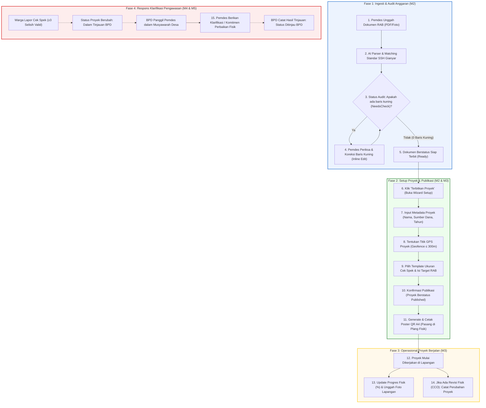

# Spesifikasi PRD: Fitur Portal & Alur Kerja Pemerintah Desa (Pemdes)

> **Modul:** M2 (Audit RAB) & M3 (Project Management Pemdes)  
> **Versi Dokumen:** 1.2 (Revisi: alur unggah RAB & status implementasi per 26 Nov 2026)  
> **Owner:** Dev 2 (Lead Backend & Alur Pemdes)  
> **Dokumen Acuan:** PRD Fitur Inti v1.1 (Bagian 3 & 4), PRD Arsitektur v1.2, PRD v1.2 Adendum Strategis  
> **Status:** Implementasi berjalan. Sisa pekerjaan di Bagian 10 (S6 Dev 1, S7 Dev 2)  
> **Versi PDF/DOCX:** dibangun dari `docs/prd/generator/generate-pemdes-spec.cjs`. Keputusan D1–D19 lengkap ada di versi PDF Bagian 4, dan status implementasi per area di Bagian 5.

> **Yang berubah di v1.2:** alur unggah RAB ditetapkan (D17–D19): berkas selalu langkah pertama, jalur AI dan Isi Manual bertemu di satu layar review, pembacaan AI asinkron dengan batas waktu tunggal, serta kuota AI & contoh RAB untuk demo. Ditambah status story dan tugas lanjutan (Bagian 10).

> **Yang berubah di v1.1:** prinsip pemilik data (Bagian 8), satu pintu terbit, berkas asli wajib, tanpa unpublish, ukuran Cek Spek tidak bisa dihapus, pembekuan saat Dalam Tinjauan BPD, daftar kolom CCO, label harga oleh kode, snapshot target di jawaban warga, dan pemicu otomatis tinjauan BPD (invarian 6–13, Bagian 6). Ditambah hak & larangan Pemdes per status (Bagian 9) dan AC PD-11 s.d. PD-18.

---

## 1. Executive Summary & Posisi Pemdes

### 1.1 Posisi Peran dalam Tata Kelola Desa
Dalam kerangka tata kelola UU No. 6 Tahun 2014 tentang Desa dan Permendagri No. 20 Tahun 2018 tentang Pengelolaan Keuangan Desa:
* **Pemerintah Desa (Kepala Desa & Tim Pelaksana Kegiatan / TPK)** adalah **Eksekutif / Penyelenggara**: Pihak yang memegang dokumen sah APBDes/RAB, mengeksekusi pembangunan fisik, serta wajib mengumumkan rincian anggaran kepada masyarakat (Pasal 82 UU Desa).
* **Warga Desa** adalah **Auditor Partisipatif Lapangan**: Mengakses transparansi tanpa login, melakukan pembuktian fisik di lokasi proyek melalui *Cek Spek*.
* **BPD (Badan Permusyawaratan Desa)** adalah **Pengawas Internal & Penengah**: Mengawal dokumen musyawarah, menerima eskalasi ketika laporan warga menunjukkan selisih fisik nyata, dan memanggil Pemdes untuk musyawarah klarifikasi.

### 1.2 Urgensi Fitur Pemdes
Data yang ditampilkan kepada warga di halaman publik (`/p/{slug}`) tidak muncul begitu saja. Pemdes adalah **hulu dari seluruh data**:
1. Menjadi pintu masuk pengunggahan dokumen RAB asli.
2. Memverifikasi pembacaan kecerdasan buatan (AI Parser) agar angka yang dipublikasikan 100% valid secara hukum.
3. Menetapkan titik geofence proyek (koordinat GPS) agar fitur Cek Spek warga terkunci pada radius $\le 300$ meter.
4. Menentukan parameter ukuran teknis (misal: tebal rabat beton, lebar jalan) yang wajib diukur warga.
5. Memperbarui progres fisik berkala dan mengunggah bukti foto lapangan.

---

## 2. Diagram Alur Kerja Pemdes (End-to-End Workflow)



---

## 3. Matriks Alur Langkah demi Langkah (Step-by-Step Flow)

| # | Aktor (Pemdes) | Sistem (Sonar Desa) | Penanganan Error / Kondisi Khusus |
|---|---|---|---|
| **1** | Masuk ke Dashboard Pemdes (`/desa`) dan klik tombol **"Unggah Dokumen RAB"** | Menampilkan halaman unggah (`/audits/create`) dengan drag-and-drop area dan opsi "Isi Manual" | File non-PDF/JPG/PNG atau ukuran $> 10$ MB ditolak langsung di client dengan pesan validasi ramah |
| **2** | Memilih berkas RAB dan klik **"Proses Dokumen"** | Berkas disimpan ke disk privat, membuat baris `audits` (`status: reading`), dan menjalankan background job pembacaan AI | Jika antrean $> 60$ detik atau AI gagal membaca: status berubah `read_failed`, file tidak hilang, tombol "Coba Lagi" dan "Isi Manual" aktif |
| **3** | Membuka rincian hasil pembacaan (`/audits/{audit}`) | Menampilkan tabel item RAB lengkap dengan perbandingan Standar Harga SSH Gianyar, label warna (Hijau, Merah, Kuning, Abu-abu), dan kalkulator selisih | Baris kuning (`NeedsCheck`) di-pin atau disorot agar operator fokus memeriksa bagian anomali |
| **4** | Memeriksa & mengoreksi baris kuning | Mengubah angka volume/harga secara inline atau menekan "Konfirmasi Sesuai Dokumen". Label harga dan total deviasi langsung dihitung ulang seketika (deterministik PHP) | Pemdes dapat menghapus baris duplikat atau subtotal yang keliru dibaca oleh AI |
| **5** | Menekan tombol **"Terbitkan Proyek"** | Sistem memeriksa prasyarat: **Wajib 0 baris kuning** dan **Cek total selisih**. Jika lolos, membuka modal/wizard setup proyek | Jika masih ada baris kuning: tombol terkunci (disabled) dengan pesan: *"Selesaikan pemeriksaan N baris kuning sebelum menerbitkan"* |
| **6** | Mengisi formulir Wizard Setup Publikasi | Menampung: (1) Nama Proyek, (2) Jenis Pekerjaan, (3) Sumber Dana & Tahun, (4) Koordinat GPS, (5) Nilai target ukuran fisik Cek Spek | Jika total RAB tertulis beda dengan jumlah baris, muncul checkbox wajib: *"Saya sudah memeriksa ketidakcocokan total ini"* (F3) |
| **7** | Mengisi titik koordinat lokasi proyek | Menyediakan tombol *"Gunakan Lokasi Saya Saat Ini"* (GPS HP/laptop) atau field input manual *Latitude, Longitude* | Koordinat wajib berada dalam batas wilayah wajar Kabupaten Gianyar |
| **8** | Mengisi ukuran Cek Spek dari template jenis proyek | Menampilkan daftar ukuran wajib sesuai jenis proyek yang dipilih (mis. Rabat Beton: Tebal, Lebar, Panjang). Pemdes mengisi angka target RAB dan panduan cara ukurnya | Ukuran template wajib tidak boleh dihapus. Pemdes diperbolehkan menambah ukuran kustom hingga maksimal 5 parameter (F19) |
| **9** | Konfirmasi **"Terbitkan ke Publik"** | `PublishProject` (satu-satunya pintu terbit) memeriksa berkas asli, 0 baris kuning, GPS, dan seluruh ukuran kunci, lalu mengubah `audits.status = 'published'`, membuat/mengaktifkan baris `projects` (`public_status: none`, `published_at: now()`), dan men-generate slug publik | Halaman proyek langsung live di `/p/{slug}` dan terdaftar di direktori publik desa `/d/{village}`. Jika ada prasyarat yang kurang, proyek tidak terbit dan langkah wizard yang kurang ditandai |
| **10** | Mengunduh/Mencetak Poster QR | Menampilkan view cetak A4 siap cetak (`GET /projects/{project}/qr`) berisi QR Code beresolusi tinggi, nama kegiatan, pagu dana, dan ajakan audit warga | Tampilan didesain hemat tinta dan ramah printer kantor desa |
| **11** | Selama pembangunan: input progres berkala | Form input persentase progres fisik ($0-100\%$) dan unggah 1–5 foto dokumentasi lapangan | Gambar otomatis dikonversi ke format WebP (maks 1600 px) dan seluruh metadata sensitif EXIF/GPS dibersihkan (A15) |
| **12** | Jika terjadi perubahan teknis di lapangan (CCO) | Form edit data proyek/item. Sistem mencatat jejak perubahan ke `project_changes` | Proyek tidak kembali ke draf, melainkan mencatat riwayat publik transparan: *"Tanggal X: Semen Rp72.000 -> Rp75.000"*. Saat proyek Dalam Tinjauan BPD, CCO item/ukuran/GPS terkunci |

---

## 4. Spesifikasi Antarmuka & Detail Layar Pemdes

### 4.1 Layar 1: Dashboard Utama Pemdes (`GET /desa`)
* **Header:** Menampilkan identitas desa (mis. *"Pemerintah Desa Melinggih, Kab. Gianyar"*).
* **Statistik Cepat (Metric Cards):**
  - Total Proyek Fisik
  - Proyek Aktif Terbit (Sudah ada di hadapan publik)
  - Draf Audit (Sedang diproses / butuh review)
  - Total Laporan Warga Masuk
* **Daftar Tabel Proyek:**
  - Kolom: Nama Proyek, Sumber Dana, Progres Fisik (Progress Bar), Status Publik (Normal / Dalam Tinjauan / Ditinjau), Aksi.
  - Aksi per baris: `Kelola Proyek`, `Cetak Poster QR`, `Lihat Tampilan Warga`.

### 4.2 Layar 2: Ekstraksi & Review Audit (`GET /audits/{id}`)
* **Dual-View Split Screen (Desktop):**
  - **Sisi Kiri:** Penampil dokumen PDF/gambar asli yang diunggah berstempel (untuk referensi mata manusia).
  - **Sisi Kanan:** Tabel hasil ekstraksi AI.
* **Komponen Filter Label:**
  - Tab Filter: *Semua Item*, *Perlu Dicek (Kuning)*, *Di Atas Standar (Merah)*, *Sesuai Standar (Hijau)*, *Tanpa Acuan (Netral)*.
* **Inline Table Editor:**
  - Baris Kuning menampilkan badge `Perlu Dicek` dengan alasan (mis. *"Satuan berbeda: sak vs kg"* atau *"Deviasi perkalian baris"*).
  - Aksi cepat di baris kuning: tombol *"Sudah Benar"* (menyetujui bacaan AI) atau input langsung untuk membetulkan angka.
* **Bar Informasi Total (Total Consistency Check):**
  - Menampilkan perbandingan: `Total Tertulis di Berkas` vs `Hasil Penjumlahan Baris`.
  - Jika selisih $> Rp1.000$, menampilkan alert informatif dan kotak persetujuan manual.

### 4.3 Layar 3: Wizard Setup Publikasi (Modal / Dedicated Step)
Layar ini muncul saat tombol *"Terbitkan Proyek"* ditekan dari audit yang sudah bersih dari baris kuning:
1. **Bagian 1: Identitas Administratif**
   - Nama Proyek (otomatis terisi dari judul RAB, dapat disunting).
   - Jenis Proyek (Dropdown: *Rabat Beton, Pembangunan Saluran / Irigasi, Pembangunan Gedung / Balai, Penerangan Jalan Umum / PJU, Lainnya*).
   - Sumber Dana (Dropdown: *Dana Desa (DDS), Alokasi Dana Desa (ADD), Pendapatan Asli Desa (PADes), Bantuan Keuangan Kabupaten*) & Tahun Anggaran.
2. **Bagian 2: Penentuan Titik Koordinat Lapangan**
   - Input Titik Koordinat: Tombol *"Ambil Koordinat Saya Sekarang"* (mengaktifkan navigator geolocation perangkat operator desa) atau input teks latitude/longitude manual.
   - Peta visual mini / konfirmasi teks titik koordinat.
3. **Bagian 3: Parameter Ukuran Cek Spek (Kunci Pembuktian Fisik)**
   - Sistem memuat template otomatis berdasarkan pilihan jenis proyek:
     - *Rabat Beton*: Panjang (m), Lebar (m), Tebal (cm).
     - *Saluran Irigasi*: Panjang (m), Lebar Dalam (cm), Tinggi Dinding (cm).
     - *Penerangan Jalan (PJU)*: Jumlah Titik (unit), Tinggi Tiang (m).
   - Operator desa mengisi angka target sesuai perencanaan RAB.
   - Kolom petunjuk cara ukur (misal: *"Ukur ketebalan beton di tepi bekisting jalan pada minimal 3 titik"*).
4. **Tombol Eksekusi:** *"Terbitkan Halaman Publik Sekarang"*.

### 4.4 Layar 4: Kelola Proyek Berjalan (`GET /desa/projects/{id}`)
* **Panel Update Progres Fisik:**
  - Slider / Input angka progres: $0\% - 100\%$.
  - Area unggah foto progres lapangan (maksimal 5 foto per unggahan).
  - Preview foto yang sudah diunggah dengan tanggal pengambilan.
* **Aksi Dokumen & QR:**
  - Tombol *"Cetak Poster QR A4"*: Membuka jendela cetak browser ke route `/projects/{project}/qr`.
  - Tombol *"Lihat Dokumen RAB Asli"*.
* **Panel Riwayat Perubahan (CCO):**
  - Form pencatatan addendum: jika ada perubahan spek atau harga material di tengah pelaksanaan, Pemdes memasukkan rincian alasan dan nilai baru.
  - Saat proyek Dalam Tinjauan BPD, form ini tampil terkunci dengan keterangan netral: *"Perubahan data dibuka kembali setelah BPD menyelesaikan tinjauan"*.
  - Tidak ada tombol hapus ukuran, hapus proyek, atau tarik dari publik.

---

## 5. Hubungan Data: Setup Pemdes $\rightarrow$ Render Halaman Warga

Setiap elemen yang disiapkan oleh Pemdes memiliki pemetaan langsung ke komponen publik warga:

| Komponen di Sisi Pemdes | Disimpan Pada Kolom DB | Komponen Render di Sisi Warga (`/p/{slug}`) | Peran Bagi Warga |
|---|---|---|---|
| Judul & Sumber Dana | `projects.name`, `fund_source`, `year` | `ProjectHero.vue` & `ProjectHeader.vue` | Mengetahui nama kegiatan, tahun, dan asal anggaran negara |
| File Asli Berstempel | `audits.file_path` | Tombol `Lihat Dokumen Asli` di `ProjectHero.vue` | Menjamin transparansi: tabel web berasal dari dokumen fisik sah |
| Verifikasi Item RAB | `audit_items.*` | `ProjectItems.vue` (Tabel rincian harga) | Warga tahu rincian material, harga satuan, dan selisih terhadap standar resmi |
| Koordinat GPS Proyek | `projects.lat`, `projects.lng` | `LocationGate.vue` (Geofence radius $\le 300$ m) | Mengunci Cek Spek: warga harus benar-benar berada di lokasi fisik proyek |
| Template Ukuran Teknis | `project_measurements.*` | `ProjectMeasurements.vue` & form Cek Spek | Memberikan instrumen terukur: warga tahu tebal/panjang jalan yang dijanjikan |
| Upload Foto Progres | `progress_photos.*` | `ProjectProgress.vue` (Galeri linimasa) | Memantau perkembangan fisik dari waktu ke waktu tanpa harus selalu ke lokasi |
| Catatan Revisi / CCO | `project_changes.*` | `ProjectChanges.vue` (Linimasa perubahan) | Mengawasi jika terjadi perubahan spesifikasi di tengah pengerjaan |

---

## 6. Aturan Bisnis & Invarian Kritis (Engineering Invariants)

1. **Gatekeeper Baris Kuning (Zero Warning Policy):**
   Proyek berstatus audit **dilarang keras diterbitkan** (`AuditStatus::Published`) selama masih terdapat minimal 1 baris berstatus `PriceLabel::NeedsCheck` (kuning). Operator Pemdes wajib mengonfirmasi atau membetulkannya terlebih dahulu.
2. **Kewajiban Pengukuran Fisik (F19):**
   Setiap proyek fisik yang diterbitkan **wajib memiliki minimal 1 parameter ukuran Cek Spek** (`project_measurements`). Proyek tanpa ukuran fisik tidak dapat diterbitkan karena meniadakan fungsi pengawasan warga.
3. **Pembersihan Metadata & Privasi Foto (A15 & UU PDP):**
   Foto progres yang diunggah oleh Pemdes wajib melalui proses sanitasi backend: diubah ke format WebP (sisi terpanjang $\le 1600$ px) dan metadata EXIF/GPS dihapus sebelum disimpan ke storage.
4. **Immutabilitas Dokumen Terbit:**
   Setelah proyek diterbitkan, dokumen audit asli dan item RAB tidak boleh dihapus diam-diam. Setiap perubahan nilai wajib tercatat secara transparan pada tabel `project_changes` dan dapat dibaca oleh publik.
5. **Bahasa Netral & Anti-Slop:**
   Seluruh antarmuka Pemdes tidak boleh menggunakan istilah yang memojokkan atau berkonotasi pidana (misal: "mark-up", "korupsi", "manipulasi"). Gunakan terminologi netral: *"Di atas standar harga"*, *"Perlu pemeriksaan"*, dan *"Penjelasan BPD"*.
6. **Satu Pintu Terbit (D8):**
   Hanya `PublishProject` yang boleh mengisi `published_at`. Form proyek manual (`CreateDesaProject`) dialihfungsikan menjadi jalur **"Isi Manual"**: menghasilkan `audit_items` lalu masuk gatekeeper dan wizard yang sama, tanpa bisa menerbitkan sendiri.
7. **Berkas Asli Wajib (D9):**
   Setiap proyek terbit wajib memiliki `audits.file_path`, termasuk yang lewat jalur Isi Manual.
8. **Tanpa Unpublish / Hapus Pasca-Terbit (D10):**
   Proyek terbit tidak bisa ditarik ke draf atau dihapus Pemdes. Penghentian pekerjaan dicatat sebagai CCO.
9. **Ukuran Cek Spek Tidak Bisa Dihapus Pasca-Terbit (D11):**
   `report_answers.measurement_id` memakai cascade delete, sehingga menghapus ukuran ikut menghapus jawaban warga. Penghapusan diblokir di policy/action. Nilainya hanya boleh diubah via CCO.
10. **Pembekuan Saat Dalam Tinjauan BPD (D12):**
    Selama `public_status = in_review`, item RAB, nilai ukuran, dan GPS tidak bisa diubah. Progres % dan foto tetap boleh. Diperiksa di policy, tidak hanya di UI.
11. **Daftar Kolom CCO (D13):**
    Boleh diubah: volume/harga/jumlah item, nilai target ukuran, GPS, progres %. Terkunci: berkas asli, nama, jenis, sumber dana, tahun, label harga. Setiap perubahan memanggil `RecordProjectChange` dalam transaksi yang sama. Penurunan progres wajib alasan dan tercatat.
12. **Label Harga oleh Kode & Snapshot Target (D14, D15):**
    Pemdes hanya mengoreksi data bacaan atau mengonfirmasi "Sudah Benar". Label selalu dihitung ulang `PriceLabeler`. Jawaban Cek Spek warga menyimpan nilai target yang berlaku saat laporan dikirim (koordinasi dengan pemilik modul Report).
13. **Pemicu Otomatis Tinjauan BPD (D16):**
    Saat pelapor selisih valid di siklus berjalan >= `sonar.review.threshold`, listener `ReportSubmitted` membuka siklus tinjauan (`current_cycle_id`, `public_status = in_review`, `in_review_since`). Jika siklus sudah terbuka, tidak membuka siklus baru. Pemdes tidak bisa memicu atau menutupnya.

---

## 7. Acceptance Criteria (Fitur Pemdes)

| ID | Given (Kondisi Awal) | When (Aksi Pemdes) | Then (Hasil yang Diharapkan) |
|---|---|---|---|
| **PD-01** | Operator Pemdes terautentikasi di `/desa` | Mengunggah file PDF RAB valid (40 baris) | Sistem memproses di background, status `reading`, dan menghasilkan tabel berlabel harga dalam $\le 20$ detik. |
| **PD-02** | Tabel hasil audit memiliki 2 baris berstatus kuning (`NeedsCheck`) | Operator mencoba menekan tombol "Terbitkan Proyek" | Tombol tidak dapat ditekan (disabled), sistem memunculkan peringatan untuk menyelesaikan verifikasi 2 baris kuning tersebut. |
| **PD-03** | Seluruh baris kuning telah dikonfirmasi/dikoreksi oleh operator | Operator menekan tombol "Terbitkan Proyek" | Modal Wizard Setup Publikasi terbuka, menampilkan form metadata, titik GPS, dan template ukuran Cek Spek. |
| **PD-04** | Operator memilih jenis proyek "Pembangunan Jalan Rabat Beton" | Template ukuran dimuat otomatis | Sistem secara otomatis memunculkan 3 ukuran wajib: Panjang (m), Lebar (m), dan Tebal (cm). Field tidak dapat dihapus, hanya diisi nilai targetnya. |
| **PD-05** | Form Wizard terisi lengkap dengan koordinat GPS valid | Operator mengonfirmasi publikasi | `Project` tersimpan dengan `public_status = none`, `published_at` terisi waktu saat ini, dan tautan publik `/p/{slug}` langsung aktif. |
| **PD-06** | Proyek telah berstatus terbit | Operator mengakses `/projects/{id}/qr` | Sistem menampilkan halaman poster A4 berisi kode QR vektor tajam, link pendek, dan siap cetak melalui fungsi browser print. |
| **PD-07** | Proyek sedang berjalan di lapangan | Operator mengunggah 3 foto progres dan mengatur persentase ke $50\%$ | Foto tersimpan dengan format WebP bebas EXIF, nilai `progress_pct` terupdate, dan langsung ter-render di linimasa publik `/p/{slug}`. |
| **PD-08** | Proyek telah terbit dan berjalan | Operator mengubah salah satu volume material di sistem | Sistem membuat rekaman di `project_changes`, dan perubahan tersebut tampil di riwayat publik proyek lengkap dengan nilai lama, nilai baru, dan stempel waktu. |
| **PD-11** | AI gagal membaca (`read_failed`) | Operator memilih "Isi Manual" dan mengetik baris item | Audit yang sama (berkas tetap) berisi `audit_items` berlabel, lalu lanjut ke review. Tidak ada proyek yang terbit dari langkah ini. |
| **PD-12** | Operator di form Isi Manual tanpa berkas | Menekan simpan | Ditolak dengan pesan meminta berkas asli. |
| **PD-13** | Wizard tanpa GPS atau dengan ukuran kunci dihapus | Operator mengonfirmasi publikasi | `PublishProject` menolak, proyek tidak terbit, langkah yang kurang ditandai. |
| **PD-14** | Proyek sudah terbit | Operator mencari aksi unpublish / hapus proyek | Aksi tidak tersedia, request langsung ke backend ditolak. |
| **PD-15** | Proyek terbit memiliki ukuran Cek Spek | Operator mencoba menghapus salah satu ukuran | Ditolak, ukuran dan jawaban warga tetap utuh. |
| **PD-16** | Proyek berstatus Dalam Tinjauan BPD | Operator mengubah nilai ukuran, item, atau GPS | Ditolak. Unggah foto & progres tetap berhasil. |
| **PD-17** | Proyek terbit dengan 2 pelapor selisih valid | Pelapor selisih valid ke-3 mengirim laporan | Siklus tinjauan terbuka, `public_status = in_review`, halaman warga menampilkan "Dalam Tinjauan BPD". |
| **PD-18** | Siklus tinjauan sudah terbuka | Laporan selisih berikutnya masuk | Tidak ada siklus baru. Laporan tercatat pada siklus berjalan. |

---

## 8. Matriks Kepemilikan & Penguncian Data

Setiap data yang tampil di halaman warga harus punya satu pengisi, satu momen kunci, dan satu jejak perubahan. Data yang tidak bisa menjawab ketiganya dianggap celah integritas.

| Data di halaman warga | Pengisi | Terkunci kapan | Jika berubah |
|---|---|---|---|
| Dokumen asli berstempel | Pemdes (unggah) | Saat terbit, permanen | Tidak bisa diganti |
| Baris item RAB (nama, volume, satuan, harga) | AI membaca, Pemdes mengoreksi | Saat terbit | CCO, tercatat di `project_changes` |
| Label harga & selisih standar | Kode (`PriceLabeler`) | Selalu dihitung ulang | Ikut berubah otomatis bila item berubah |
| Total pagu | Kode (jumlah baris) + konfirmasi Pemdes bila beda | Saat terbit | Mengikuti CCO item |
| Nama, jenis, sumber dana, tahun | Pemdes (wizard) | Saat terbit, permanen | Tidak bisa diubah |
| Titik GPS geofence | Pemdes (wizard) | Saat terbit | CCO, dibekukan saat Dalam Tinjauan |
| Ukuran Cek Spek | Template (kunci) + Pemdes (nilai & ukuran kustom) | Saat terbit | Nilai via CCO, tidak bisa dihapus, dibekukan saat Dalam Tinjauan |
| Progres % & foto lapangan | Pemdes (berkala) | Tidak dikunci, hanya bertambah | Penurunan progres tercatat di `project_changes` |
| Riwayat perubahan | Sistem (otomatis) | Append-only | Tidak bisa diedit atau dihapus siapa pun |
| Status Dalam Tinjauan / Ditinjau | Sistem (ambang laporan) lalu BPD | Diatur BPD | Pemdes tidak punya akses |

---

## 9. Hak & Larangan Pemdes per Status Proyek

| Status | Pemdes boleh | Pemdes tidak boleh |
|---|---|---|
| Audit `reading` / `read_failed` | Menunggu, Coba Lagi, Isi Manual | Menerbitkan |
| Audit `needs_review` (ada baris kuning) | Koreksi inline, "Sudah Benar", hapus baris duplikat/subtotal | Menerbitkan, mengubah label harga |
| Audit `ready` (0 baris kuning) | Membuka wizard, mengisi metadata, GPS, ukuran | Menerbitkan tanpa berkas, tanpa GPS, atau tanpa ukuran kunci |
| Proyek terbit, `public_status = none` | Progres & foto, CCO sesuai daftar kolom, cetak poster QR | Unpublish, hapus proyek, hapus ukuran, ganti berkas asli |
| Proyek `in_review` (Dalam Tinjauan BPD) | Progres & foto, hadir dan memberi klarifikasi di musdes (di luar aplikasi) | CCO item, ukuran, dan GPS, atau menutup tinjauan |
| Proyek `reviewed` (Ditinjau BPD) | Progres & foto, CCO sesuai daftar kolom (mis. tindak lanjut perbaikan) | Mengubah atau menghapus catatan BPD |

---

## 10. Alur Unggah RAB (v1.2) & Tugas Lanjutan

### 10.1 Keputusan baru

| # | Keputusan | Ringkasan |
|---|---|---|
| **D17** | Berkas selalu langkah pertama, satu layar review | Setiap audit dimulai dari unggah berkas di `/audits/create`. Hasil AI maupun Isi Manual (tambah baris di layar review) bertemu di `/audits/{id}`. Metadata, GPS, dan ukuran Cek Spek hanya diisi di wizard terbit. `/desa/projects/create` dipensiunkan. |
| **D18** | Pembacaan AI asinkron, batas waktu tunggal | Audit `reading` + `ProcessRabDocumentJob` di antrean, layar review melakukan polling. Batas tunggu UI, `$timeout` job, dan `retry_after` antrean diselaraskan dengan `sonar.rab_reader.timeout_seconds` (60 detik). |
| **D19** | Kuota AI & contoh RAB demo | Desa demo dibatasi `sonar.demo.upload_limit`. "Uji Contoh RAB" memakai fixture tanpa memanggil AI. `sonar.ai_budget` ditegakkan sebelum memanggil AI; jika habis, tawarkan Isi Manual. |

### 10.2 Alur

```
Dashboard /desa ──[Unggah Dokumen RAB]──► ① Unggah /audits/create (berkas / contoh)
                                              │ audit = reading, job di antrean
                                              ▼
                                         ② Sedang dibaca /audits/{id} (polling, batas 60 detik)
                                              │ berhasil              │ gagal / kuota habis
                                              ▼                       ▼
                                              │              [Coba Lagi]  [Isi Manual: tambah baris]
                                              ▼                       │
                                         ③ Review & Gatekeeper /audits/{id}  ◄─┘
                                              │ 0 baris kuning + centang F3 bila total berbeda
                                              ▼
                                         ④ Wizard Terbit: metadata → GPS → ukuran Cek Spek
                                              ▼  PublishProject
                                         ⑤ Sukses + QR ──► Kelola Proyek /desa/projects/{id}
```

### 10.3 Status story per 26 November 2026

| Story | Status | Catatan |
|---|---|---|
| S1 Upload RAB, Isi Manual & Review | Selesai | Form lama `/desa/projects/create` masih aktif, dipensiunkan di S6/S7 |
| S2 Wizard Publikasi & Geofencing | Sebagian | Bug `origin` ukuran kustom di wizard |
| S3 Poster QR A4 | Selesai | |
| S4 Progres & CCO | Selesai | |
| S5 Pemicu Tinjauan BPD | Sebagian | Aturan perangkat berbeda belum diterapkan di listener |

### 10.4 S6: Penyelesaian Frontend & QA (Dev 1)

| Prio | Task | File |
|---|---|---|
| P1 | Wizard mengirim `origin: 'custom'`, padahal backend hanya menerima `template`/`desa`, sehingga ukuran kustom gagal divalidasi. Kirim `desa`, dan saat memuat ulang petakan `desa` ke kustom | `resources/js/features/project/PublishWizardModal.vue` |
| P1 | Pensiunkan form lama (D17): tombol "Isi Manual" di dashboard ke `/audits/create`, hapus tautan ke `/desa/projects/create` | `resources/js/pages/desa/Dashboard.vue`, `ProjectCreate.vue` |
| P1 | Polling layar review: batas 60 detik (sekarang 180), ikuti status server. Pertimbangkan `usePoll` | `resources/js/pages/audit/Review.vue` |
| P2 | Baris "Sudah Benar" yang labelnya masih `needs_check` tampil di halaman warga sebagai "Tidak dapat dibandingkan", bukan "Perlu dicek" | `ProjectItems.vue`, `PriceLabel.vue` |
| P2 | Pesan netral + tombol "Uji Contoh RAB" / "Isi Manual" saat kuota AI demo habis | `resources/js/pages/audit/Create.vue` |
| QA | Jalankan TC-PD-01 s.d. TC-PD-15 (PDF Bagian 10) di HP 360 px dan desktop, termasuk cetak poster QR | - |

### 10.5 S7: Sisa Backend (Dev 2)

| Prio | Task |
|---|---|
| P1 | Hapus jalur `is_published` di `CreateDesaProject` dan route `desa.projects.create/store` setelah S6 |
| P1 | Satukan logika ambang tinjauan: listener memakai >= 3 akun **dan** >= 3 perangkat (Adendum v1.2 5.2); `EvaluateReviewThreshold` saat ini tidak dipanggil |
| P1 | Tegakkan `sonar.ai_budget`; "Uji Contoh RAB" di `/audits` memakai fixture, bukan AI |
| P2 | Selaraskan batas waktu: job 180 detik, worker produksi `--timeout=75`, `retry_after` 90 detik |
| P2 | Snapshot nilai target di jawaban warga (D15), koordinasi dengan pemilik modul Report |
| P3 | Filter katalog standar harga per kabupaten & tahun di job AI dan layar review |
